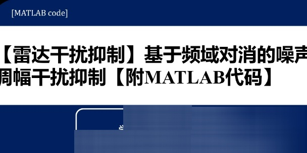

# Radar Signal Detection and Interference Rejection MATLAB Code

Study on radar reconnaissance simulation in interference environment
1. Interference Reduction
(1) Noise frequency modulation interference suppression based on empirical mode decomposition
(2) Noise modulation interference suppression based on frequency domain cancellation
(3) Noise Frequency Modulation Interference Reduction
II. Radar Signal Detection
According to the indicator requirements, the radar reconnaissance part is shown in the figure 11. This part includes signal detection, arrival time estimation, intra-pulse modulation identification, parameter estimation and signal sorting.

## Images

<!-- PAYMENT_BLOCK -->

## Get this dataset

- Payment link (Stripe): [Buy now](https://buy.stripe.com/3cs8yP7sY87d0vu9AB)
- Payment QR code: 

<!-- /PAYMENT_BLOCK -->
